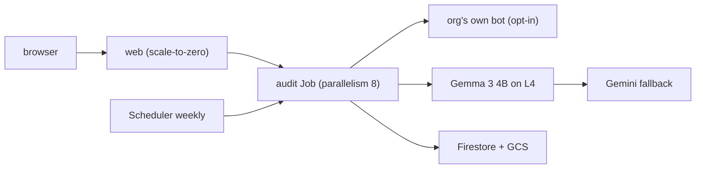

# HelplineCheck architecture (launch deep-dive)

Companion to the root [ARCHITECTURE.md](../ARCHITECTURE.md). Diagram source:
[architecture.mmd](architecture.mmd) (Mermaid — paste into any Mermaid
renderer). This page adds the launch-post depth: every service, backend,
and connection, with file pointers.

## Request path

- **Web service** (`helplinecheck-web`, `infra/cloudrun-service-web.yaml`,
  `web/`): scale-to-zero audit API + report server. `POST /api/audits`
  with `{"bot":"flawed"|"fixed"}` runs the audit inline for the demo and
  returns `{runId, summary, reportUrl}`; `GET /reports/:id` and
  `GET /reports/:id.md` serve the self-contained report (zero external
  requests, no `<script>`). minScale 0, request billing, max 10 instances.
- **Planner** (`planner/`): the failure taxonomy (7 modes grounded in the
  NEDA Tessa and NYC MyCity harm cases), strict zod wire schemas, and the
  deterministic 12-seed corpus generator. The zod schemas mirror the ADK
  planner `output_schema` 1:1, so local and cloud runs share one contract.
- **Audit-run Job** (`helplinecheck-audit`,
  `infra/cloudrun-job-audit.yaml`, `worker/`): the batch path. Parallelism
  8, up to 30 min, runs off the serving path. Triggered by executing the
  Job directly or via Pub/Sub (`helplinecheck-audit-requests`) from the
  web service (cloud path) or Cloud Scheduler (weekly Monday 9am ET job,
  `infra/scheduler.yaml` — first 3 Scheduler jobs are free).
- **Target bot**: the org's **own** bot, explicitly approved for testing.
  Opt-in only — the harness refuses any other framing in copy, landing
  page, and README.

## Judge path (verdicts only wake the GPU)

- **Gemma judge** (`helplinecheck-judge`,
  `infra/cloudrun-service-judge.yaml`, `judge/`): Gemma 3 4B via Ollama on
  1× L4 (24 GB) with 4 vCPU / 16 GiB, internal ingress, minScale 0,
  concurrency 1. GPU services idle ~10 min post-request (~$0.17/wake), so
  only verdict calls reach it; batch work stays in the Job.
- **Gemini fallback** (`judge/cloud.ts`): Developer API key, or the Vertex
  AI enterprise path. Routing (`JUDGE_MODE`: prefer-local default,
  prefer-gemma, local-only, gemma-only) skips unconfigured judges and
  stamps the winning source on every verdict — local rule judge, Gemma, or
  Gemini — so reports always show what judged what.
- **Human review** (`judge/types.ts` `needsHumanReview`, Firestore
  `reviewQueue/`): contested or high/critical verdicts queue for a human
  before publication; reports banner them as preliminary.

## Data plane

- **Pub/Sub** (`infra/cloud-notes.md`): `helplinecheck-audit-requests`
  (audit fan-in; 10 GiB/mo free) and `helplinecheck-budget-alerts`.
- **Firestore**: `auditRuns/{runId}` summaries, per-case records, and the
  `reviewQueue/` — written by the Job, read by the web service.
- **GCS**: one immutable, self-contained `report.html` + `report.md` +
  `summary.json` per run under `reports/{runId}/`, served immutable.
- **Budget** (`infra/budget.sh`): $5 monthly cap with email + Pub/Sub
  alerts at 50/90/100% of spend plus 100% of forecast.

## Cost envelope

One 15–30 min audit ≈ **$0.35**: the L4 min instance costs ~$1.05/hr, so
$0.35 ≈ 20 min of full-instance runtime, and scale-to-zero plus the Job
(not service) shape avoids idle billing between audits.

